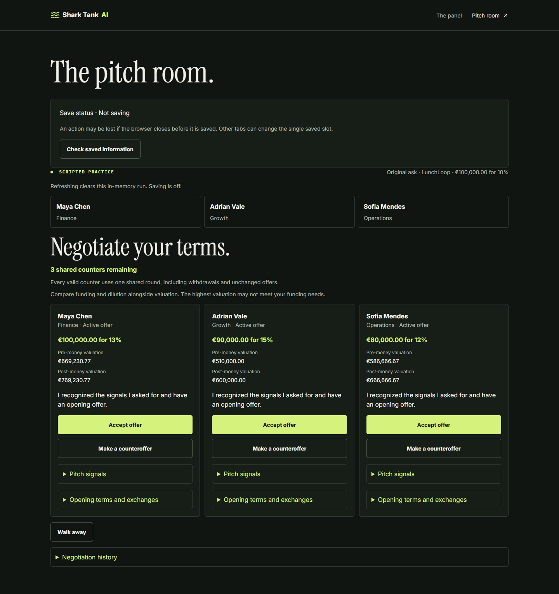
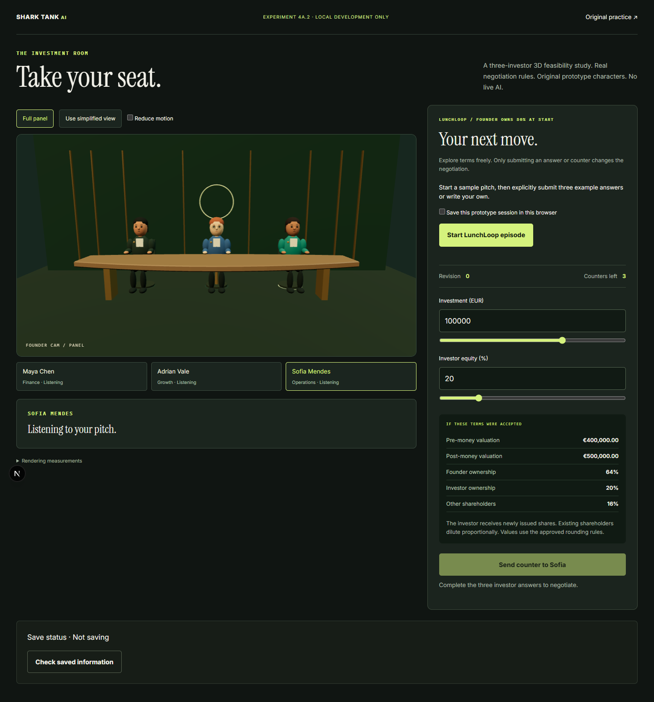

# Shark Tank AI

University Introduction to Programming group project: pitch a startup to three fictional investors, defend assumptions, negotiate investment and learn how ownership changes.

**Use develop.** Main remains the historical initial branch and repository default. Published product checkpoint: [21745d6](https://github.com/SalvadorCarvalhal673/Shark-Tank-AI/commit/21745d658f6855c5601525dea56ca76ad823e8cd).

## Current functionality

Pitch validation; Maya Chen(finance), Adrian Vale(growth), Sofia Mendes(operations); deterministic questions/evidence patterns; competing offers; three shared counters; concessions/withdrawals; explicit acceptance; four outcomes; factual debrief; exact valuation/dilution; optional local saving/replay/recovery and multi-tab coordination.
The separate development-only 3D studio has independently animated characters, directed cameras, character picking, HTML financial controls and simplified fallback. **Graphics are temporary feasibility assets. Live AI is not implemented.** Scripted text signals do not independently verify business facts. Premium narrative-game visuals, contextual AI and coaching are proposed work.




## Install and launch

Install Git and Node.js 24.x with bundled npm(npm 10+).
```sh
git clone --branch develop https://github.com/SalvadorCarvalhal673/Shark-Tank-AI.git
cd Shark-Tank-AI
npm ci
npm run dev -- --hostname 127.0.0.1 --port 3000
```
Open http://127.0.0.1:3000 for landing, /simulate for complete practice, /prototype/studio for the feasibility slice. Enter 3D, start LunchLoop and explicitly submit three sample/custom answers before countering.
No API key, database or environment configuration is needed. Windows PowerShell blocking npm.ps1: use npm.cmd/npx.cmd, not a weaker execution policy. [Platform setup](docs/START-HERE.md).

## Checks

```sh
npm run lint
npm test
npm run build
npm run typecheck
npx playwright install chromium
npm run test:e2e
```
See [TESTING](docs/TESTING.md) for the separate prototype suite and browser settings. Coverage:136 unit tests and94 browser scenarios(82 original+12 prototype). Production intentionally returns404 for the prototype route.

## Contribute and explore

Read [AGENTS.md](AGENTS.md), [CONTRIBUTING.md](CONTRIBUTING.md) and an available [Issue](https://github.com/SalvadorCarvalhal673/Shark-Tank-AI/issues). Create an issue-linked feature branch and reviewed PR into develop.
- [Start here](docs/START-HERE.md), [architecture](docs/ARCHITECTURE.md), [history](docs/DEVELOPMENT-HISTORY.md)
- [Roadmap](docs/ROADMAP.md), [task backlog/workstreams](docs/TASK-BACKLOG.md), [milestones](https://github.com/SalvadorCarvalhal673/Shark-Tank-AI/milestones)
- [Finance](docs/FINANCIAL-ENGINE.md), [negotiation](docs/NEGOTIATION-ENGINE.md), [persistence](docs/SESSION-PERSISTENCE.md)
- [3D studio](docs/3D-STUDIO.md), [future AI](docs/AI-INTEGRATION.md), [UX](docs/USER-EXPERIENCE.md), [design guidelines](docs/DESIGN-GUIDELINES.md), [design resources](docs/design/README.md)
- [Testing](docs/TESTING.md), [handover verification](docs/HANDOVER-VERIFICATION.md), [security](docs/security-exceptions.md), [asset provenance](docs/studio-assets.md)

**SE-001 remains unresolved. Public deployment is prohibited pending separate security clearance and approval.** Zero production-audit findings do not clear vendored framework code. Never assume audit fix --force is a remediation.
Physical Android/iPhone performance, Safari/WebKit, spoken screen readers, production performance certification and final art remain open. Phone viewport emulation is desktop hardware.
