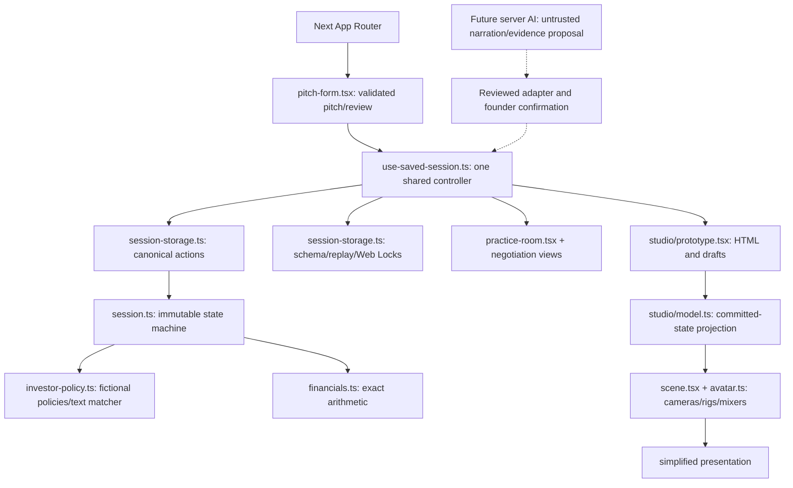

# Architecture

No animation or AI callback is authoritative for financial outcomes.

## Exact source map

| Source relative to src/ | Responsibility |
| --- | --- |
| app/page.tsx; app/layout.tsx; app/globals.css; components/header.tsx | Landing, local fonts, visual system/navigation |
| app/simulate/page.tsx | Complete scripted practice entry |
| app/prototype/studio/page.tsx and studio.css | Development-only 3D slice and scoped styling |
| features/simulation/pitch.ts | Exact decimal/range/currency validation and formatting |
| features/simulation/pitch-form.tsx | Intake/review/save choice and controller ownership |
| features/simulation/practice-room.tsx | Questions, competing offers, actions, debrief |
| features/simulation/negotiation/use-saved-session.ts | Run, dispatch, saving acknowledgments, resume/retry/removal/conflicts |
| features/simulation/negotiation/session-storage.ts | Canonical journal, exact bounded schema, replay and coordinated writes |
| features/simulation/negotiation/session.ts | Frozen snapshots, session/revision checks, offer lifecycle/state machine |
| features/simulation/negotiation/investor-policy.ts | Versioned policies and deterministic unverified text signals |
| features/simulation/negotiation/financials.ts | Valuations and proportional primary-issuance cap table |
| features/simulation/negotiation/presentation.ts | Reasons, pending revision-bound offers, ownership adapter |
| features/simulation/negotiation/offer-card.tsx; terms-display.tsx | Interactive offers and readable terms |
| features/simulation/negotiation/history.tsx; debrief.tsx | Ordered exchanges, factual assessment and consequences |
| features/simulation/negotiation/recovery-panel.tsx | Explicit recovery/removal/status/error UI |
| features/studio/prototype.tsx | Accessible controls, drafts and same saved-session hook |
| features/studio/model.ts | Pure cues, camera presets and preview adapter |
| features/studio/avatar.ts | Skeleton-aware clones, independent mixers/materials, disposal |
| features/studio/scene.tsx | Lazy WebGL2 scene, local loader, room, cameras, gestures/diagnostics |

Early practice.ts/panel.ts remain historical helpers with tests; current practice uses the advanced engine. There is no database, authentication, live AI endpoint or multiplayer.
Redesign layouts/assets/adapters within issues. Preserve integer units, reducer actions, session/revision and offer IDs, counter budgets, immutable snapshots, ordered history and schema 1/rules 1. Changes to these contracts need coordinated review and independent tests.
One controller owns domain state. Canvas failure removes only rendering, preserving drafts/run/journal/save. Do not store GPU resources/camera timing. Future transcript persistence requires reviewed version/consent decisions. See the focused engine guides.
