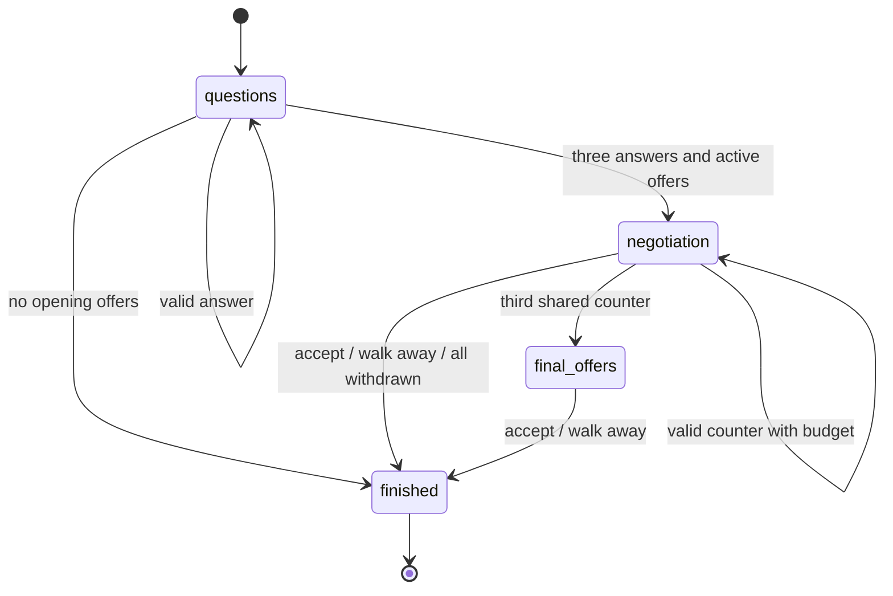

# Negotiation engine

Authority: src/features/simulation/negotiation/session.ts, investor-policy.ts, presentation.ts. Detailed policy reference: the adjacent source README. Tests: negotiation-session.test.ts, negotiation-presentation.test.ts and journey/UI browser suites.

Fresh run IDs, sessionId+expectedRevision-bound actions and frozen snapshots protect state. Invalid/stale/duplicate/wrong-session actions preserve object/revision/budget. Each applied action increases revision once and may append multiple ordered events. Terminal runs cannot accept new actions.

| Investor | Cash/ask | Equity premium | Floor reduction from opening | Cash ceiling/ask | Withdrawal band below floor |
| --- | ---: | ---: | ---: | ---: | ---: |
| Maya,finance |100% |3 percentage points |2 points |100% |3 points |
| Adrian,growth |90% |5 points |3 points |90%,100% if an acquisition measure is detected |4 points |
| Sofia,operations |80% |2 points |1 point |80% |2 points |
Opening equity caps at100%; floor is opening less total concession, minimum1bp. Cash shares round half up and remain at least one minor unit.
Counter cash above ceiling or equity strictly below floor minus withdrawal band causes withdrawal. At/above floor and within ceiling: agree to exact proposed terms. Otherwise concede at most1 percentage point from current equity without crossing original floor; cash is lesser of current/requested. Unchanged offers retain IDs. Repeated negotiation never resets floors.
Three counters are shared across investors; preview edits consume none. Superseded terms remain in history. Agreement leaves an active offer; explicit acceptance closes competing offers and records one deal.
Four terminal reasons: accepted-deal, no-offers, all-withdrawn, founder-walk-away.

Evidence requires selected recognized financial/target/channel/customer/milestone text patterns. Repetition/selected negation excludes some signals. This is not general language understanding, independent verification or a startup-quality grade. It may miss valid phrasing or accept fabricated affirmative content. Preserve that caveat.
